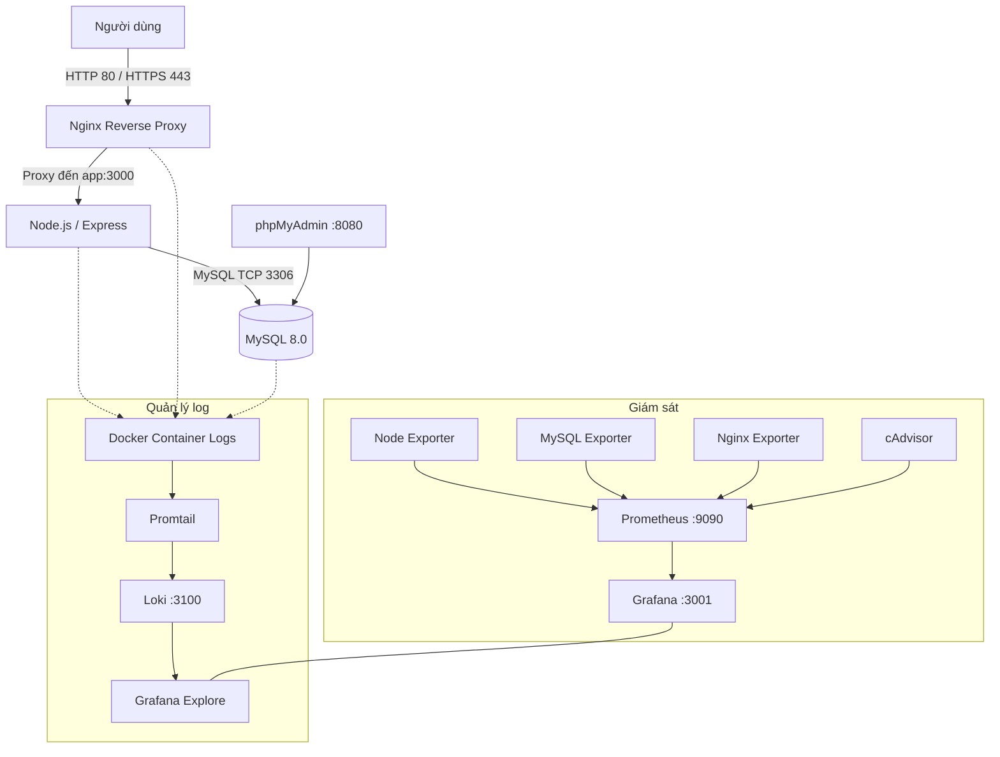

# 🚀 Hệ thống Diễn đàn & Giám sát Containerized — Đề 15

Hệ thống diễn đàn trực tuyến được xây dựng bằng Node.js, Express, EJS và MySQL 8.0, triển khai bằng Docker Compose. Dự án tích hợp Nginx Reverse Proxy với HTTPS, Prometheus và Grafana để giám sát hệ thống, cùng Loki và Promtail để thu thập, lưu trữ và truy vấn log tập trung.

Dự án hướng đến việc thực hành triển khai, quản trị, giám sát và bảo mật một ứng dụng web chạy trong môi trường container.

## 📑 Mục lục

- [1. Giới thiệu](#1-giới-thiệu)
- [2. Tính năng](#2-tính-năng)
- [3. Kiến trúc hệ thống](#3-kiến-trúc-hệ-thống)
- [4. Công nghệ sử dụng](#4-công-nghệ-sử-dụng)
- [5. Cấu trúc thư mục](#5-cấu-trúc-thư-mục)
- [6. Yêu cầu hệ thống](#6-yêu-cầu-hệ-thống)
- [7. Cài đặt và triển khai](#7-cài-đặt-và-triển-khai)
- [8. Cấu hình biến môi trường](#8-cấu-hình-biến-môi-trường)
- [9. Truy cập hệ thống](#9-truy-cập-hệ-thống)
- [10. Hướng dẫn sử dụng diễn đàn](#10-hướng-dẫn-sử-dụng-diễn-đàn)
- [11. Giám sát với Prometheus và Grafana](#11-giám-sát-với-prometheus-và-grafana)
- [12. Quản lý log với Loki và Promtail](#12-quản-lý-log-với-loki-và-promtail)
- [13. Quản trị cơ sở dữ liệu](#13-quản-trị-cơ-sở-dữ-liệu)
- [14. Vận hành và bảo trì](#14-vận-hành-và-bảo-trì)
- [15. Xử lý sự cố](#15-xử-lý-sự-cố)
- [16. Bảo mật](#16-bảo-mật)
- [17. Kiểm thử và nghiệm thu](#17-kiểm-thử-và-nghiệm-thu)
- [18. Hạn chế và hướng phát triển](#18-hạn-chế-và-hướng-phát-triển)

---

## 1. Giới thiệu

### 1.1. Mục tiêu

Xây dựng một hệ thống diễn đàn có thể triển khai và quản lý bằng Docker Compose, đồng thời tích hợp các công cụ phổ biến trong quy trình vận hành hệ thống:

- Container hóa ứng dụng và cơ sở dữ liệu.
- Sử dụng Nginx làm Reverse Proxy và điểm truy cập HTTPS.
- Quản lý dữ liệu bằng MySQL 8.0.
- Thu thập metrics bằng Prometheus và các exporter.
- Trực quan hóa metrics bằng Grafana.
- Thu thập log container bằng Promtail.
- Lưu trữ và truy vấn log bằng Loki.
- Sử dụng Docker volumes để duy trì dữ liệu qua các lần khởi động lại container.

### 1.2. Phạm vi

Dự án gồm hai nhóm chức năng chính:

**Ứng dụng diễn đàn**
- Đăng ký tài khoản.
- Đăng nhập và đăng xuất.
- Xem danh sách chủ đề.
- Tạo chủ đề mới.
- Xem nội dung chi tiết của chủ đề.
- Đăng bình luận vào chủ đề.
- Lưu thông tin người dùng, chủ đề và bình luận trong MySQL.

**Triển khai và vận hành**
- Điều phối các dịch vụ bằng Docker Compose.
- Định tuyến yêu cầu HTTP/HTTPS qua Nginx.
- Theo dõi metrics với Prometheus và Grafana.
- Thu thập log tập trung với Loki và Promtail.
- Quản trị MySQL bằng phpMyAdmin.

## 2. Tính năng

| Nhóm | Tính năng |
|---|---|
| Tài khoản | Đăng ký, đăng nhập, đăng xuất |
| Diễn đàn | Danh sách chủ đề, tạo chủ đề, xem chi tiết |
| Bình luận | Đăng bình luận vào chủ đề |
| Cơ sở dữ liệu | MySQL 8.0, Sequelize ORM |
| Reverse Proxy | Nginx, chuyển hướng HTTP sang HTTPS |
| Bảo mật ứng dụng | Băm mật khẩu bằng bcrypt, session cookie có cấu hình bảo mật |
| Monitoring | Prometheus, Node Exporter, MySQL Exporter, Nginx Exporter, cAdvisor |
| Dashboard | Grafana |
| Logging | Promtail, Loki, LogQL |
| Container | Docker Compose, bridge network, named volumes |

Các tính năng giám sát và logging cần được kiểm tra trực tiếp sau khi triển khai để xác nhận toàn bộ luồng dữ liệu hoạt động bình thường.

## 3. Kiến trúc hệ thống

### 3.1. Sơ đồ tổng thể



### 3.2. Luồng hoạt động

1. Người dùng truy cập ứng dụng qua Nginx.
2. Nginx chuyển tiếp yêu cầu đến ứng dụng Node.js tại cổng 3000.
3. Ứng dụng sử dụng Sequelize để thao tác với MySQL.
4. Prometheus định kỳ thu thập metrics từ các target được khai báo.
5. Grafana sử dụng Prometheus làm nguồn dữ liệu giám sát.
6. Promtail đọc log Docker từ máy chủ và gửi đến Loki.
7. Grafana có thể sử dụng Loki làm nguồn dữ liệu log sau khi được cấu hình.

**Lưu ý:** Docker Compose hiện tại chưa khai báo sẵn provisioning datasource hoặc dashboard Grafana. Nếu chưa cấu hình thủ công, bạn cần thêm Prometheus và Loki làm data source trước khi sử dụng.

## 4. Công nghệ sử dụng

| Thành phần | Công nghệ | Cổng | Vai trò |
|---|---|---|---|
| Web Application | Node.js 20, Express | 3000 | Xử lý nghiệp vụ diễn đàn |
| Template Engine | EJS | — | Hiển thị giao diện |
| ORM | Sequelize | — | Làm việc với MySQL |
| Reverse Proxy | Nginx Alpine | 80, 443 | Tiếp nhận và định tuyến HTTP/HTTPS |
| Database | MySQL 8.0 | 3306 nội bộ | Lưu trữ dữ liệu |
| Database Admin | phpMyAdmin | 8080 trên host | Quản trị MySQL |
| Metrics | Prometheus | 9090, chỉ bind localhost | Thu thập metrics |
| Dashboard | Grafana | 3001 trên host | Hiển thị metrics và log |
| Logging | Loki | 3100, chỉ bind localhost | Lưu trữ log |
| Log Agent | Promtail | — | Thu thập và gửi log |
| Nginx Metrics | Nginx Exporter | 9113 nội bộ | Thu thập metrics Nginx |
| MySQL Metrics | MySQL Exporter | 9104 nội bộ | Thu thập metrics MySQL |
| Host Metrics | Node Exporter | 9100 nội bộ | Thu thập metrics hệ thống |
| Container Metrics | cAdvisor | 8080 nội bộ | Thu thập metrics container |

Các cổng nội bộ không nhất thiết được publish ra máy chủ. Trong cấu hình hiện tại, MySQL không publish cổng 3306 ra host; Prometheus và Loki chỉ bind trên `127.0.0.1`.

## 5. Cấu trúc thư mục

Cấu trúc dưới đây phản ánh các đường dẫn đã xuất hiện trong cấu hình Compose. Hãy điều chỉnh cây thư mục nếu repository có thêm hoặc khác các file này.

```text
forum-project/
├── server.js
├── package.json
├── package-lock.json
├── .env.example
├── .gitignore
├── docker-compose.yml
├── nginx/
│   ├── conf.d/
│   │   └── forum.conf
│   └── certs/
│       ├── forum.crt
│       └── forum.key
├── monitoring/
│   ├── prometheus/
│   │   └── prometheus.yml
│   ├── loki/
│   │   └── loki-config.yml
│   ├── promtail/
│   │   └── promtail-config.yml
│   └── mysql/
│       └── exporter.cnf
├── views/
├── public/
└── README.md
```

**Lưu ý:** Không đưa private key, mật khẩu thật hoặc file `.env` chứa secret vào repository công khai. Nếu tên file hoặc vị trí thực tế khác với cây trên, cần cập nhật lại tài liệu.

## 6. Yêu cầu hệ thống

- Git.
- Docker Engine hoặc Docker Desktop.
- Docker Compose V2.
- Kết nối Internet trong quá trình tải image.
- Máy chủ có đủ RAM và dung lượng lưu trữ cho ứng dụng, MySQL, metrics và log.
- Các cổng 80, 443, 8080 và 3001 không bị ứng dụng khác chiếm nếu muốn sử dụng các port mapping mặc định.

Kiểm tra phiên bản:

```bash
docker --version
docker compose version
git --version
```

Đối với Ubuntu, cần bảo đảm Docker Engine và Docker Compose plugin đã được cài đặt và người dùng có quyền chạy Docker.

## 7. Cài đặt và triển khai

### 7.1. Clone repository

Thay URL mẫu bằng địa chỉ repository thực tế:

```bash
git clone https://github.com/<YOUR_USERNAME>/forum-project.git
cd forum-project
```

### 7.2. Kiểm tra cấu hình

```bash
docker compose config --services
docker compose config --quiet
```

Nếu cấu hình yêu cầu biến môi trường nhưng chưa có, hãy tạo file `.env` và bổ sung các giá trị bắt buộc trước khi tiếp tục.

### 7.3. Tạo file môi trường

Nếu repository có `.env.example`:

```bash
cp .env.example .env
```

Trên Windows PowerShell:

```powershell
Copy-Item .env.example .env
```

Chỉnh sửa file `.env`, thay toàn bộ giá trị mẫu bằng thông tin riêng của môi trường triển khai.

Không sử dụng mật khẩu minh họa trong môi trường thật.

### 7.4. Chuẩn bị chứng chỉ HTTPS

Nginx đang sử dụng hai file:

```text
nginx/certs/forum.crt
nginx/certs/forum.key
```

Hãy bảo đảm hai file tồn tại và tương ứng với nhau trước khi khởi chạy Nginx.

Đối với môi trường thử nghiệm, có thể sử dụng chứng chỉ tự ký. Trình duyệt có thể hiển thị cảnh báo vì chứng chỉ chưa được cấp bởi tổ chức chứng thực được tin cậy.

Đối với môi trường production, nên sử dụng chứng chỉ hợp lệ phù hợp với tên miền.

### 7.5. Cài đặt dependencies Node.js

Ứng dụng sử dụng các package được khai báo trong `package.json`. Kiểm tra cách cài dependencies mà repository đang sử dụng.

Nếu chạy trực tiếp trên máy host, có thể cài bằng:

```bash
npm ci
```

Lệnh này yêu cầu có `package-lock.json` đồng bộ với `package.json`.

**Lưu ý:** Compose hiện tại sử dụng image `node:20`, mount thư mục dự án vào `/app` và chạy `node server.js`, nhưng không có lệnh `npm install` trong cấu hình. Vì vậy, cần bảo đảm các dependencies có sẵn trong môi trường container trước khi khởi chạy. Nếu chưa có, hãy bổ sung bước cài dependencies hoặc xây dựng Dockerfile phù hợp.

### 7.6. Khởi chạy hệ thống

```bash
docker compose up -d --build
```

Kiểm tra trạng thái:

```bash
docker compose ps
```

Xem log ứng dụng:

```bash
docker compose logs --tail=100 app
```

Xem log toàn bộ hệ thống:

```bash
docker compose logs --tail=100
```

Theo dõi log realtime:

```bash
docker compose logs -f app nginx mysql
```

Ứng dụng cần kết nối MySQL thành công trước khi bắt đầu lắng nghe tại cổng 3000. Hãy kiểm tra log nếu container khởi động thất bại.

### 7.7. Kiểm tra endpoint sức khỏe

Ứng dụng có endpoint:

```text
GET /health
```

Kiểm tra trực tiếp trên máy chủ:

```bash
curl http://127.0.0.1:3000/health
```

Kết quả mong đợi khi ứng dụng đã khởi động:

```json
{
  "status": "ok"
}
```

Endpoint này xác nhận ứng dụng trả lời yêu cầu HTTP; nó không thay thế việc kiểm tra toàn bộ chức năng database, logging và monitoring.

## 8. Cấu hình biến môi trường

Các biến dưới đây được sử dụng trong cấu hình Compose và mã nguồn đã cung cấp.

| Biến | Chức năng | Bắt buộc |
|---|---|---|
| `MYSQL_DATABASE` | Tên database | Có |
| `MYSQL_USER` | Tài khoản MySQL của ứng dụng | Có |
| `MYSQL_PASSWORD` | Mật khẩu tài khoản MySQL | Có |
| `MYSQL_ROOT_PASSWORD` | Mật khẩu tài khoản root MySQL | Có |
| `SESSION_SECRET` | Secret ký session của Express | Có |
| `GRAFANA_ADMIN_PASSWORD` | Mật khẩu admin Grafana | Có |

`DB_HOST` và `DB_PORT` được thiết lập trong Compose lần lượt là `mysql` và `3306`.

Ví dụ cấu trúc file `.env`:

```dotenv
MYSQL_DATABASE=forum_db
MYSQL_USER=forum_user
MYSQL_PASSWORD=<YOUR_STRONG_MYSQL_PASSWORD>
MYSQL_ROOT_PASSWORD=<YOUR_STRONG_ROOT_PASSWORD>
SESSION_SECRET=<YOUR_LONG_RANDOM_SESSION_SECRET>
GRAFANA_ADMIN_PASSWORD=<YOUR_STRONG_GRAFANA_PASSWORD>
```

Thay các placeholder bằng giá trị thật trên máy triển khai. Không commit file `.env` lên GitHub.

`SESSION_SECRET` nên là chuỗi ngẫu nhiên dài, khó đoán. Không tái sử dụng mật khẩu database hoặc mật khẩu Grafana làm session secret.

**Lưu ý về MySQL:** Các biến khởi tạo của image MySQL thường chỉ được áp dụng khi khởi tạo data directory trống. Nếu volume đã chứa database, thay đổi mật khẩu trong `.env` không tự động đổi mật khẩu của tài khoản hiện có trong MySQL.

## 9. Truy cập hệ thống

### 9.1. Các dịch vụ

| Dịch vụ | Địa chỉ mẫu | Ghi chú |
|---|---|---|
| Forum qua HTTPS | `https://192.168.80.128` | Thay IP bằng IP thực tế của máy chủ |
| Forum trực tiếp | `http://localhost:3000` | Cổng ứng dụng đang publish ra host |
| phpMyAdmin | `http://localhost:8080` | Quản trị database |
| Grafana | `http://localhost:3001` | Dashboard và Explore |
| Prometheus | `http://127.0.0.1:9090` | Chỉ bind localhost |
| Loki API | `http://127.0.0.1:3100` | Chỉ bind localhost |

Trên máy tính khác trong cùng mạng, thay `localhost` bằng IP máy chủ đối với các cổng có thể truy cập từ bên ngoài. Prometheus và Loki hiện chỉ bind localhost, nên không thể truy cập trực tiếp qua IP máy chủ theo cấu hình này.

HTTP cổng 80 được cấu hình chuyển hướng sang HTTPS. Vì vậy, địa chỉ HTTP không phải điểm truy cập cuối cùng của ứng dụng.

### 9.2. Đăng nhập Grafana

- Username mặc định theo cấu hình image: `admin`.
- Password: giá trị `GRAFANA_ADMIN_PASSWORD` trong `.env`.

Đổi mật khẩu mặc định hoặc mật khẩu yếu trước khi đưa hệ thống lên mạng.

### 9.3. Đăng nhập phpMyAdmin

phpMyAdmin được cấu hình kết nối đến service `mysql`.

Sử dụng tài khoản MySQL thực tế đã được khởi tạo. Không mặc định rằng tài khoản `root` hoặc mật khẩu mới trong `.env` sẽ hoạt động nếu volume database đã tồn tại từ trước.

### 9.4. Tài khoản diễn đàn

Ứng dụng hiện không khai báo tài khoản admin diễn đàn được tạo sẵn. Người dùng có thể đăng ký tài khoản mới từ giao diện đăng ký.

Không sử dụng tài khoản `admin/admin123` trừ khi bạn đã chủ động tạo tài khoản đó trong ứng dụng.

## 10. Hướng dẫn sử dụng diễn đàn

### 10.1. Đăng ký

1. Truy cập trang diễn đàn.
2. Mở trang đăng ký.
3. Nhập tên đăng nhập, email và mật khẩu.
4. Gửi biểu mẫu đăng ký.
5. Sau khi đăng ký thành công, chuyển đến trang đăng nhập.

Ứng dụng kiểm tra định dạng tên đăng nhập, email và độ dài mật khẩu. Mật khẩu được băm bằng bcrypt trước khi lưu vào database.

### 10.2. Đăng nhập và đăng xuất

1. Mở trang đăng nhập.
2. Nhập tên đăng nhập và mật khẩu.
3. Sau khi đăng nhập, người dùng có thể tạo chủ đề và bình luận.
4. Sử dụng chức năng đăng xuất để kết thúc phiên làm việc.

### 10.3. Tạo chủ đề

1. Đăng nhập vào hệ thống.
2. Mở chức năng tạo chủ đề mới.
3. Nhập tiêu đề và nội dung.
4. Gửi bài viết.
5. Mở trang chi tiết để xem nội dung.

### 10.4. Bình luận

1. Mở một chủ đề.
2. Đăng nhập nếu chưa có phiên làm việc.
3. Nhập nội dung bình luận.
4. Gửi bình luận và kiểm tra nội dung được hiển thị.

Các thao tác ghi dữ liệu được thực hiện qua Sequelize và MySQL.

## 11. Giám sát với Prometheus và Grafana

### 11.1. Prometheus

Cấu hình Prometheus được mount từ:

```text
monitoring/prometheus/prometheus.yml
```

Chu kỳ scrape được cấu hình là 15 giây.

Các target được khai báo:

| Job | Target |
|---|---|
| `prometheus` | `prometheus:9090` |
| `nginx` | `nginx-exporter:9113` |
| `mysql` | `mysql-exporter:9104` |
| `node` | `node-exporter:9100` |
| `cadvisor` | `cadvisor:8080` |

Truy cập Prometheus trên máy chủ:

```text
http://127.0.0.1:9090/targets
```

Kiểm tra trạng thái target. `UP` cho biết Prometheus scrape thành công tại thời điểm kiểm tra; `DOWN` cần được điều tra theo log và cấu hình exporter.

### 11.2. Grafana

Truy cập:

```text
http://localhost:3001
```

Đăng nhập bằng `admin` và mật khẩu `GRAFANA_ADMIN_PASSWORD`.

Nếu chưa có data source, thực hiện cấu hình thủ công:

**Prometheus**
- Loại data source: Prometheus.
- URL khi truy cập từ container Grafana: `http://prometheus:9090`.

**Loki**
- Loại data source: Loki.
- URL khi truy cập từ container Grafana: `http://loki:3100`.

Grafana và các service nằm trong cùng Docker network `forum-net`, nên sử dụng tên service để giao tiếp nội bộ.

Sau khi thêm data source, kiểm tra chức năng Save & test. Dashboard chỉ xuất hiện nếu đã được tạo hoặc import.

### 11.3. Exporter và dữ liệu metrics

Các exporter được cấu hình để cung cấp metrics cho Prometheus:

- Node Exporter: metrics hệ thống máy chủ.
- MySQL Exporter: metrics MySQL.
- Nginx Exporter: metrics Nginx.
- cAdvisor: metrics container.

Nginx Exporter yêu cầu Nginx cho phép truy cập endpoint `/nginx_status`. Nếu target Nginx bị `DOWN`, cần kiểm tra cấu hình `stub_status`, quyền truy cập IP và log exporter.

MySQL Exporter yêu cầu thông tin xác thực hợp lệ trong file cấu hình exporter.

## 12. Quản lý log với Loki và Promtail

### 12.1. Luồng log

Promtail được cấu hình đọc log Docker JSON từ đường dẫn:

```text
/var/lib/docker/containers/*/*-json.log
```

Sau đó gửi log đến:

```text
http://loki:3100/loki/api/v1/push
```

Loki sử dụng filesystem storage với volume `forum_loki_data`.

Cấu hình nằm tại:

```text
monitoring/loki/loki-config.yml
monitoring/promtail/promtail-config.yml
```

### 12.2. Truy vấn log trong Grafana

1. Truy cập Grafana.
2. Mở **Explore**.
3. Chọn data source Loki.
4. Kiểm tra các label có sẵn.
5. Nhập LogQL và chạy truy vấn.

Ví dụ theo cấu hình Promtail đã cung cấp:

```logql
{job="docker"}
```

Tìm các dòng log có chứa từ `error`:

```logql
{job="docker"} |= "error"
```

Tìm các dòng có chứa từ `nginx`:

```logql
{job="docker"} |= "nginx"
```

Các truy vấn này lọc trên label `job="docker"` đã khai báo trong Promtail. Chúng chỉ trả về kết quả nếu Promtail gửi log thành công và Loki có dữ liệu trong khoảng thời gian đã chọn.

Cấu hình Promtail hiện tại chưa khai báo label `container="forum-app"`, vì vậy không nên mặc định truy vấn `{container="forum-app"}` sẽ hoạt động.

### 12.3. Kiểm tra khi không thấy log

```bash
docker compose logs --tail=100 promtail
docker compose logs --tail=100 loki
```

Kiểm tra:
- Promtail đọc được file log Docker.
- Endpoint Loki truy cập được.
- Log Promtail không có lỗi gửi dữ liệu.
- Grafana đã cấu hình đúng Loki data source.
- Khoảng thời gian truy vấn bao phủ thời điểm log được tạo.

## 13. Quản trị cơ sở dữ liệu

### 13.1. Truy cập qua phpMyAdmin

Truy cập `http://localhost:8080` trên máy chủ hoặc dùng địa chỉ IP phù hợp từ máy khác.

Sử dụng thông tin tài khoản MySQL đã được cấu hình.

### 13.2. Truy cập MySQL CLI

```bash
docker compose exec mysql mysql -u root -p
```

Nhập mật khẩu root khi được yêu cầu.

Kiểm tra database:

```sql
SHOW DATABASES;
USE forum_db;
SHOW TABLES;
```

Nếu `MYSQL_DATABASE` khác `forum_db`, hãy thay tên database tương ứng.

Ứng dụng sử dụng Sequelize `sync()` khi khởi động để đồng bộ các model `User`, `Topic` và `Comment`. Cách đồng bộ này không thay thế một quy trình migration được quản lý chặt chẽ cho môi trường production.

### 13.3. Backup database

Ví dụ tạo bản sao lưu database:

```bash
docker compose exec -T mysql sh -c \
  'exec mysqldump -u root -p"$MYSQL_ROOT_PASSWORD" "$MYSQL_DATABASE"' \
  > forum_backup.sql
```

Lệnh này dùng các biến môi trường bên trong container MySQL. Hãy kiểm tra file backup được tạo và có dữ liệu trước khi coi việc sao lưu là thành công.

### 13.4. Restore database

Restore cần được thực hiện sau khi xác nhận đúng database đích và có bản backup hợp lệ.

Ví dụ:

```bash
docker compose exec -T mysql sh -c \
  'exec mysql -u root -p"$MYSQL_ROOT_PASSWORD" "$MYSQL_DATABASE"' \
  < forum_backup.sql
```

Không restore trực tiếp lên database đang chứa dữ liệu quan trọng nếu chưa có phương án sao lưu và phục hồi.

### 13.5. Docker volumes

Các volume được khai báo trong Compose:

- `forum_mysql_data`
- `forum_prometheus_data`
- `forum_grafana_data`
- `forum_loki_data`
- `forum_promtail_positions`

Các volume này giúp dữ liệu tồn tại qua việc tạo lại container, miễn là volume không bị xóa.

**Cảnh báo:** Không chạy `docker compose down -v` nếu muốn giữ dữ liệu MySQL, metrics, Grafana và Loki.

## 14. Vận hành và bảo trì

### Xem trạng thái container

```bash
docker compose ps
```

### Xem log một service

```bash
docker compose logs --tail=100 app
docker compose logs --tail=100 nginx
docker compose logs --tail=100 mysql
```

### Theo dõi log realtime

```bash
docker compose logs -f app
```

### Khởi động lại một service

```bash
docker compose restart app
```

### Dừng hệ thống

```bash
docker compose down
```

Lệnh này dừng và xóa các container thuộc project nhưng giữ các named volumes đã khai báo.

### Khởi động lại

```bash
docker compose up -d
```

### Rebuild service ứng dụng

```bash
docker compose up -d --build app
```

Lưu ý rằng image `node:20` hiện không cài dependencies qua Dockerfile riêng. Trước khi rebuild hoặc triển khai trên máy mới, cần bảo đảm các package Node.js đã sẵn sàng.

### Kiểm tra volume

```bash
docker volume ls
```

Không chạy `docker system prune -a` một cách tùy tiện trên máy chủ dùng chung vì lệnh này có thể xóa các image không được sử dụng và ảnh hưởng đến những dự án khác.

## 15. Xử lý sự cố

| Sự cố | Nguyên nhân có thể | Hướng xử lý |
|---|---|---|
| `port is already allocated` | Cổng đã được tiến trình khác sử dụng | Kiểm tra cổng đang chiếm và điều chỉnh port mapping nếu cần |
| Container `app` thoát | Thiếu dependencies, sai `.env` hoặc lỗi ứng dụng | Chạy `docker compose logs app` |
| Không kết nối được MySQL | MySQL chưa sẵn sàng hoặc thông tin kết nối sai | Kiểm tra `docker compose ps`, log MySQL và biến môi trường |
| Nginx trả về 502 | Ứng dụng không lắng nghe tại cổng 3000 hoặc proxy sai | Kiểm tra log Nginx và ứng dụng |
| HTTPS không hoạt động | Thiếu chứng chỉ, khóa hoặc cấu hình TLS sai | Kiểm tra `forum.crt`, `forum.key` và log Nginx |
| Prometheus target `DOWN` | Exporter chưa chạy hoặc endpoint không truy cập được | Kiểm tra `/targets` và log exporter |
| Không có metrics MySQL | Tài khoản exporter hoặc kết nối DB sai | Kiểm tra file `exporter.cnf` và quyền truy cập |
| Không có log trong Grafana | Promtail không đọc hoặc không gửi log | Kiểm tra log Promtail và Loki |
| Không có dashboard Grafana | Chưa tạo hoặc import dashboard | Tạo dashboard hoặc cấu hình provisioning |
| Không đăng nhập được phpMyAdmin | Sai tài khoản hoặc mật khẩu MySQL | Xác minh tài khoản hiện có trong MySQL |
| Mất dữ liệu sau triển khai | Volume bị xóa hoặc database được khởi tạo lại | Kiểm tra volume và quy trình backup/restore |

## 16. Bảo mật

### 16.1. Các biện pháp hiện có trong mã nguồn và cấu hình

- Nginx chuyển hướng HTTP sang HTTPS.
- Nginx cấu hình các header bảo mật cơ bản.
- Mật khẩu người dùng được băm bằng bcrypt.
- Session cookie có các thuộc tính `httpOnly`, `sameSite` và tùy chọn `secure`.
- MySQL không publish cổng 3306 trực tiếp ra host.
- Prometheus và Loki chỉ bind vào địa chỉ loopback của máy chủ.
- Mật khẩu Grafana được truyền qua biến môi trường.

Các biện pháp trên cần được kiểm tra trong môi trường chạy thực tế; chúng không tự động bảo đảm hệ thống an toàn tuyệt đối.

### 16.2. Những điểm cần lưu ý

- Không commit `.env`, mật khẩu hoặc secret vào GitHub.
- Không công khai private key của chứng chỉ HTTPS.
- Thay đổi mật khẩu mặc định và dùng mật khẩu mạnh.
- phpMyAdmin đang publish trên cổng 8080; nên giới hạn truy cập bằng firewall hoặc chỉ bind localhost nếu không cần truy cập từ xa.
- Ứng dụng đang publish cổng 3000 trực tiếp trên host. Nếu muốn mọi lưu lượng phải đi qua Nginx, cần bỏ port mapping này hoặc chỉ bind vào localhost.
- cAdvisor đang chạy với `privileged: true`. Cần đánh giá và giảm quyền nếu có thể.
- Không đưa Grafana, phpMyAdmin hoặc endpoint quản trị ra Internet mà không có cơ chế kiểm soát truy cập phù hợp.
- Chứng chỉ tự ký phù hợp cho thử nghiệm, không tương đương với chứng chỉ được trình duyệt tin cậy trong môi trường production.
- Nếu dùng session trong production, cần đánh giá cấu hình cookie `secure` và cấu hình proxy tin cậy của Express trước khi bật chế độ này.

## 17. Kiểm thử và nghiệm thu

Sử dụng checklist sau để kiểm tra hệ thống sau khi triển khai.

### Ứng dụng

- [ ] `docker compose config --quiet` hoàn thành thành công.
- [ ] Các container cần thiết đang hoạt động.
- [ ] Endpoint `/health` trả về trạng thái `ok`.
- [ ] Đăng ký tài khoản thành công.
- [ ] Đăng nhập và đăng xuất hoạt động.
- [ ] Tạo chủ đề và đăng bình luận thành công.
- [ ] Dữ liệu được lưu trong MySQL.
- [ ] Nginx chuyển hướng HTTP sang HTTPS.
- [ ] HTTPS hoạt động với chứng chỉ đã cấu hình.

### Giám sát

- [ ] Prometheus truy cập được trên máy chủ.
- [ ] Các scrape target cần thiết ở trạng thái `UP`.
- [ ] Node Exporter cung cấp metrics.
- [ ] MySQL Exporter cung cấp metrics.
- [ ] Nginx Exporter truy cập được `nginx_status`.
- [ ] cAdvisor cung cấp metrics container.
- [ ] Grafana kết nối thành công đến Prometheus.

### Logging

- [ ] Promtail đọc được log Docker.
- [ ] Loki nhận log.
- [ ] Grafana kết nối thành công đến Loki.
- [ ] LogQL truy vấn được log thực tế.

### Bảo trì và bảo mật

- [ ] File `.env` không được commit lên GitHub.
- [ ] Không có mật khẩu thật trong README.
- [ ] Dữ liệu tồn tại sau khi restart container.
- [ ] Backup và restore database được kiểm tra.
- [ ] Các cổng publish đã được rà soát.
- [ ] Các cấu hình quyền truy cập container đã được đánh giá.

Chỉ đánh dấu một mục là hoàn thành sau khi đã thực hiện kiểm tra thực tế.

## 18. Hạn chế và hướng phát triển

Các hạng mục dưới đây là đề xuất cải tiến, không mặc định rằng chúng đã được triển khai:

- Bổ sung Dockerfile riêng cho ứng dụng Node.js để quản lý dependencies ổn định.
- Thêm healthcheck cho các dịch vụ phù hợp.
- Tự động provision Prometheus và Loki data source trong Grafana.
- Xây dựng dashboard giám sát ứng dụng, database, Nginx và container.
- Hoàn thiện phân quyền và bảo vệ các giao diện quản trị.
- Thiết lập quy trình backup định kỳ và kiểm tra phục hồi.
- Bổ sung migration database và quy trình triển khai có kiểm soát.
- Thêm kiểm thử tự động và quy trình CI/CD.
- Đánh giá việc giảm quyền container, đặc biệt với cAdvisor.
- Hoàn thiện quản lý secret và chính sách lưu trữ log.

---

**Đề tài:** Hệ thống Diễn đàn & Giám sát Containerized — Đề 15

**Công nghệ chính:** Node.js, Express, EJS, MySQL 8.0, Docker Compose, Nginx, Prometheus, Grafana, Loki và Promtail.

**Repository:** Thay URL mẫu bằng đường dẫn GitHub thực tế của dự án.
